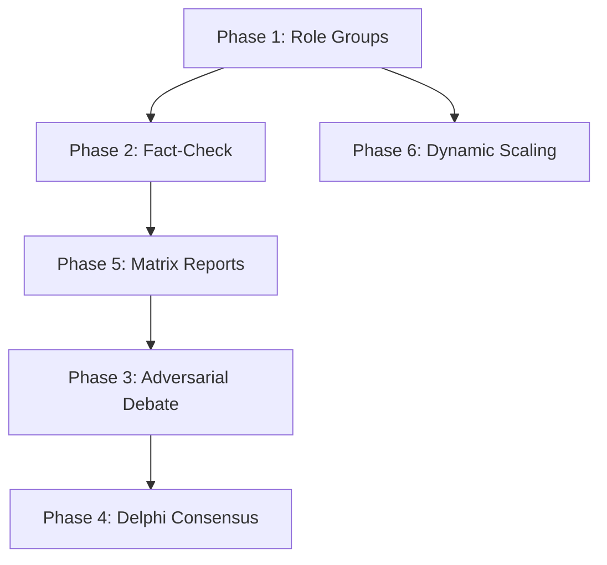

# 🗺️ Smart Orchestrator v2 — Implementation Guides

> **Branch**: `v2` | **Source Spec**: [SMART_ORCHESTRATOR_v2.md](../SMART_ORCHESTRATOR_v2.md)

## Implementation Order

Each phase is designed to be **independently shippable** and **backward-compatible**.
Implement them in order, commit after each, and test before moving to the next.

```
Phase 1 → Phase 2 → Phase 5 → Phase 6 → Phase 3 → Phase 4
(role)    (fact)    (matrix)   (scale)    (debate)   (consensus)
```

## Phase Guides

| # | Phase | Doc | Effort | Risk | Status |
|---|---|---|---|---|---|
| 1 | [Role Groups & Structured Dispatch](./PHASE_1_ROLE_GROUPS.md) | Schema + prompt changes | ~1–2d | 🟢 Low | ✅ |
| 2 | [Fact-Check Phase](./PHASE_2_FACT_CHECK.md) | New pipeline stage + claims verification | ~3–4d | 🟡 Med | ✅ |
| 5 | [Matrix Reports](./PHASE_5_MATRIX_REPORTS.md) | Structured comparison output | ~2–3d | 🟢 Low | ✅ |
| 6 | [Dynamic Scaling](./PHASE_6_DYNAMIC_SCALING.md) | Complexity-based agent count | ~2d | 🟢 Low | ✅ |
| 3 | [Adversarial Debate](./PHASE_3_ADVERSARIAL_DEBATE.md) | Red Team vs Research multi-turn debate | ~4–5d | 🔴 High | ✅ |
| 4 | [Delphi Consensus](./PHASE_4_DELPHI_CONSENSUS.md) | Iterative convergence scoring | ~3–4d | 🔴 High | ✅ |

## Dependency Graph



## DB Migration Notes

Phases 2, 3, 4, 5 add new columns to the `Job` model. Since the project uses `SQLModel.metadata.create_all()`:
- **Simplest approach**: Delete `data/app.db` after each phase to recreate the schema.
- **Better approach**: Use `ALTER TABLE` statements or set up Alembic migrations.

## Git Workflow Suggestion

```bash
# After completing each phase:
git add -A
git commit -m "v2: Phase N — <phase name>"

# After all phases pass testing:
git checkout main
git merge v2
```
